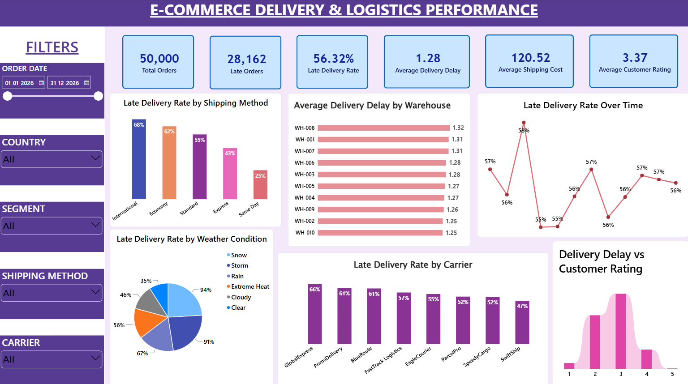

# E-Commerce Delivery & Logistics Performance Analysis

This project analyzes e-commerce delivery and logistics performance using **MySQL and Power BI**.

The objective is to understand delivery performance, identify patterns associated with late deliveries, and examine how logistics factors vary across shipping methods, carriers, warehouses, weather conditions, and time periods.

The project follows a business analytics workflow:

**Business Problem → SQL Analysis → KPI Development → Power BI Dashboard → Business Insights**

## 🎯 Business Problem

An e-commerce company wants to understand its delivery performance and identify areas where delays are more frequently observed.

The analysis focuses on questions such as:

- What percentage of orders are delivered late?
- Which shipping methods have higher late-delivery rates?
- How do late-delivery rates vary across carriers?
- Which warehouses have higher average delivery delays?
- How does delivery performance vary across weather conditions?
- How does late-delivery performance change over time?
- How do delivery delays relate to customer ratings?

The findings can help operations and logistics teams identify areas that require further investigation and monitoring.

## 📌 Key KPIs

- Total Orders
- Late Orders
- Late Delivery Rate
- Average Delivery Delay
- Average Shipping Cost
- Average Customer Rating

## Dataset

The dataset contains **50,000 e-commerce orders** and includes information related to:

- Order and customer details
- Customer segment and location
- Warehouse information
- Product category and weight
- Shipping method and carrier
- Delivery distance
- Promised and actual delivery days
- Delivery status and delay
- Shipping cost
- Order priority
- Weather condition
- Customer rating
- Delivery attempts
- Warehouse processing time

### Key Columns

| Column | Description |
|---|---|
| `order_id` | Unique order identifier |
| `order_date` | Date of order |
| `customer_segment` | Customer segment |
| `warehouse_id` | Warehouse handling the order |
| `shipping_method` | Shipping method used |
| `carrier` | Delivery carrier |
| `distance_km` | Delivery distance |
| `promised_delivery_days` | Promised delivery duration |
| `actual_delivery_days` | Actual delivery duration |
| `late_delivery` | Whether the order was delivered late |
| `delivery_delay_days` | Number of days delayed |
| `shipping_cost_usd` | Shipping cost |
| `weather_condition` | Weather condition |
| `customer_rating` | Customer rating |
| `delivery_attempts` | Number of delivery attempts |
| `warehouse_processing_hours` | Warehouse processing time |

## 🛠️ Tools & Technologies

- **MySQL** — Data storage and SQL analysis
- **Power BI** — Dashboard development and visualization
- **DAX** — KPI and measure calculations
- **Power Query** — Data preparation
- **SQL** — Aggregation, grouping, filtering, and business analysis

## 🔍 SQL Analysis

The dataset was imported into MySQL and analyzed using SQL queries.

Key analyses included:

- Overall late-delivery rate
- Late-delivery rate by shipping method
- Late-delivery rate by carrier
- Average delivery delay by warehouse
- Warehouse processing time vs delivery delay
- Delivery delay vs customer rating
- Late-delivery rate by distance group
- Late-delivery rate by weather condition
- Late-delivery rate by delivery attempts
- Late-delivery rate by order priority
- Promised vs actual delivery time

## Dashboard

